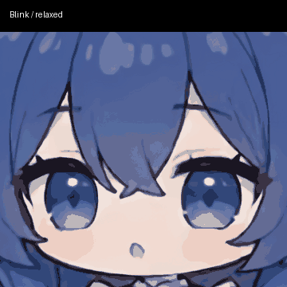
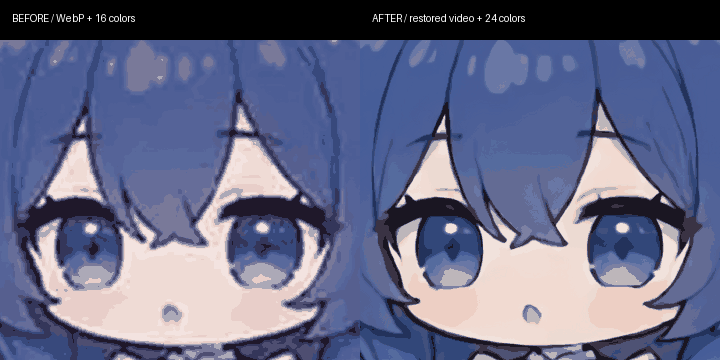

# 大肥鱼语音贴脸模式

ESP32-S3-N32R16、360×360 屏幕可选用 [32 MB / 20 fps 流畅配置](./DAFEIYU_SMOOTH_32M_CN.md)，
通过更多连续源帧改善运动，保留本页描述的紧凑配置作为兼容与回退选项。

唤醒智能体后说 **“进入贴脸模式”**，角色以约 **1.2 秒**的缓入缓出过渡从全身拉近到脸部。
说 **“退出贴脸模式”** 或 **“恢复全身”**，按相反方向退回全身。
贴脸空闲时会在完整眨眼之间穿插笑脸、好奇歪头、困倦揉眼，不再只重复同一组眨眼。
平静表情停留约 3.3–5.1 秒，小表情持续约 1.1–1.8 秒，一轮约 29.4 秒。



上图读取固件的实际轮换顺序和素材帧率生成。动作之间回到平静表情，当前仍为二维动画切换。


预览为资源效果示意，实际板端还会叠加原有状态图标和字幕。
现有素材来自二维动画帧，效果通过预渲染取景、裁剪和放大实现。

### 360×360 清晰度优化

这一档改为从 `PC2005-cloud/dsh-pet` 的原始 VP9 视频直接解码，避免 WebP quality=68 的再次压缩。
离线使用 waifu2x-ncnn-vulkan 的 cunet 模型、降噪等级 2、4 倍放大重建线条，
中间帧保存为无损 PNG，再生成屏幕实际尺寸的 EAF。全身、眨眼、其他表情及镜头过渡采用同一处理流程。
处理后使用 24 色，减少原先 16 色造成的色块；不使用抖动来伪造颜色，因此不会额外引入颗粒。
完整眨眼和过渡帧数保持不变，超分辨率只在电脑导入素材时运行，不增加 ESP32 的运行时推理负担。



源视频本身只有 640×360，脸部区域更小，因此这是降噪与线条重建，不是恢复真实的高分辨率原画。
320×240 和 1024×600 两档仍使用之前的素材。

## 使用和烧录

在 `idf.py menuconfig` 的 **Example Configuration** 保持以下选项开启：

- `Use Dafeiyu character animations`
- `Enable Dafeiyu voice-controlled close-up view`（默认开启）
- 使用小智时开启 `Enable Xiaozhi agent`

在 ESP-IDF 环境中重新构建并完整烧录：

```powershell
cd examples/agent/chatbot
idf.py build
idf.py -p COMx flash monitor
```

替换实际串口。**必须执行完整 `flash`**：本功能同时修改固件和 `anim_icon` 中的动画资源，
单独 `app-flash` 会缺少特写素材，串口将提示检查资源。

工程目前没有 VoCat v1.9 专用板级配置，仍需沿用已验证的板型、引脚及屏幕配置。
本功能不修改硬件引脚，资源根据屏幕配置选择。

支持的直接口令：

| 作用 | 口令 |
| --- | --- |
| 拉近 | 进入贴脸模式、开启贴脸模式、打开贴脸模式 |
| 退远 | 退出贴脸模式、关闭贴脸模式、恢复全身、恢复全身模式、进入全身模式 |

允许句首的“请”“帮我”及句尾常见标点。直接匹配完整口令，避免将
“不要进入贴脸模式”“什么是贴脸模式”等句子当作操作。
口令读取现有 Agent 的语音识别文本，仍依赖当前智能体的识别链路。

小智同时注册两个无参数 MCP 工具，方便模型理解其他自然说法：

- `Custom.Dafeiyu.EnterCloseUp`
- `Custom.Dafeiyu.ExitCloseUp`

直接口令收到识别文本后就开始切换，不必等待模型调用工具。随后重复的工具调用不会
重新播放过渡。Coze/OpenAI 也走同一语音文本事件，因此支持上表中的直接口令。

## 显示规则

- 视角与工作状态分别保存。贴脸时，说话、思考、成功、失败等表情会使用相应脸部素材；
  DSH 同步状态也使用当前视角。
- 过渡用待机姿态作为取景基准，结束后显示最新的会话/DSH 表情。过渡期间的表情更新
  只记录最新值；已经过期的云端情绪不再补播。
- 过渡为 18 帧、15 fps、约 1.2 秒。倍率使用几何插值配合缓入缓出，避免末段突然放大。
  重复进入/退出不重播；反向请求在当前过渡结束后执行，
  避免突然跳回另一端。
- 小智语音与 DSH 的原有优先级继续生效，视角不会被它们的状态变化重置。
  重复提交同一表情不会重启动画，避免高频状态通知打断眨眼。
- 只有贴脸且当前表情为 neutral / idle / relaxed、没有云端临时表情时，才进行空闲表演。
  说话、聆听、真实思考/工作/错误状态、云端表情会在下一次显示任务 tick 接管；
  恢复空闲后从平静表情重新开始，退出贴脸后停止轮换。好奇歪头仅改变外观，不修改 DSH 任务状态。
- 视角持续到退出或重启，重启恢复全身，不写入 NVS。
- 保留状态栏和字幕，不强制跳离设置页或摄像头画面；回到角色页可看到当前视角。
- 320×240 使用 320×200 的特写画布，360×360 使用 360×320，上方留给状态栏。
  1024×600 使用居中的 400×320 画布、360×300 全身素材，以控制内存及 Flash 占用。

特写镜头按七组动作分别设置面部中心，避免抬手、低头时失去脸部。
360×360 全身、特写及过渡均使用 24 色重建素材；其他两档全身保留 64 色，特写及过渡使用 16 色。
为保留原有 **3000 KiB** 资源分区，开启本功能时使用另一套较短的动作循环；
原有全身资源保留，关闭本选项并完整烧录即可恢复原先的循环长度。
实际每组帧数和 SHA-256 记录在 `assets/dafeiyu/closeup/source.json`。
普通表情循环仍使用 12 fps。空闲表演的笑脸、歪头、揉眼另有 6 fps 别名，
复用同一组高清素材，以较慢节奏展示小动作；实际对话表情的帧率保持不变。
待机固定保留 11 张不同源帧，包含完整闭眼与睁眼过程；
睁眼停留帧复用同一压缩数据，以较小空间提供约 3 秒的眨眼周期。其余动作保留短往返循环。
预览按实际帧率播放两次眨眼后退回全身，不再冻结特写末帧。

本次以 `esp_emote_assets` 0.1.2 字体/图标打包验证：

| 屏幕资源 | 待机帧数；其余全身/特写不同帧数 | 分区镜像字节数 |
| --- | --- | --- |
| 320×240 | 11；6 / 6 | 3,067,650 |
| 360×360 | 11；3 / 3 | 3,057,690 |
| 1024×600 | 11；2 / 2 | 3,038,574 |

三档均小于 3,072,000 字节。更换字体/图标后由构建脚本重新检查容量。

## 二次开发入口

```text
语音识别事件 / 小智 MCP
  → main/modules/character_view.cpp
  → character_view_state.hpp：目标视角、过渡、最新表情、情绪有效期
  → Emote.SetEmoji / SetEmojiSegment / InsertAnimation
  → 本地 EAF 素材
```

`character_view.cpp` 的独立任务统一提交表情，避免 DSH、语音和镜头互相打断。
显示服务新增 `SetEmojiSegment(Emoji, StartFrame, EndFrame)`，以素材帧率单次播放指定的
闭区间并停在末帧。区间选择与素材选择持有同一个原生图形锁，退远不会闪现全身首帧。

`view_zoom.eaf` 的 0–17 帧用于进入，18–35 帧用于退出；两个方向共享压缩帧数据。
普通表情名保持不变，脸部版本加 `face_` 前缀。
空闲表演顺序和时长见 `character_view_state.hpp` 中的 `IDLE_EXPRESSIONS`。
`face_idle_smile`、`face_idle_curious`、`face_idle_drowsy` 是专用的慢速别名，
复用 success、thinking、idle_yawn 的 EAF，没有增加图像帧或降低清晰度。

调整取景、时长或颜色后重新生成素材：

```powershell
python examples/agent/chatbot/tools/import_dafeiyu_closeup.py --source SOURCE_DIR --enhanced ENHANCED_DIR
```

`SOURCE_DIR` 是原先的 `QCYTSN/dsh-dafeiyu` 源码目录，提交版本见原资源 `source.json`。
生成器检查源帧 SHA-256，只读取图片，需要 Pillow。日常固件打包只使用已提交素材，
不需要 Pillow、联网取图或运行上游代码。改变帧数/时长时，还需同步修改
`character_view_state.hpp` 中的 `VIEW_FRAMES` / `TRANSITION_MS`。

`ENHANCED_DIR` 用以下命令准备。需要包含固定提交的 dsh-pet Git 仓库、支持 libvpx-vp9 的 FFmpeg，
以及 [waifu2x-ncnn-vulkan 20220728](https://github.com/nihui/waifu2x-ncnn-vulkan/releases/tag/20220728)
及其 `models-cunet` 目录；本次在 Intel Iris Xe 上离线处理，不上传图片。

```powershell
python examples/agent/chatbot/tools/prepare_dafeiyu_quality.py --source SOURCE_DIR --dsh-source DSH_GIT_DIR --output ENHANCED_DIR --ffmpeg FFMPEG_EXE --upscaler WAIFU2X_EXE
python examples/agent/chatbot/tools/import_dafeiyu_closeup.py --source SOURCE_DIR --enhanced ENHANCED_DIR --resolution 360_360
```

准备脚本检查原视频 SHA-256，记录精确的视频帧号、模型/工具及重建 PNG 的摘要；
这些记录随资源保存在 `closeup/source.json` 的 `enhancement` 字段。
生成器检查重建 PNG 摘要，且禁止在缺少 `--enhanced` 时意外退回旧的 360×360 图源。

修改空闲表演后可重新生成预览：

```powershell
python examples/agent/chatbot/tools/preview_dafeiyu_idle.py --enhanced ENHANCED_DIR
```

## 验证边界

主机测试覆盖口令、重复指令、反向请求、过渡期间状态切换、情绪过期、渲染失败重试、
EAF 校验、资源来源、双向帧共享及所有表情的全身/特写映射。另使用原生 EAF 解码器
核验生成帧，并用实际字体/图标打包检查三档资源的分区容量。

本次通过 28 项主机测试、516 帧原生 RGB565 解码比对，以及 360×360 CMake 资源生成目标。
状态机测试包含同一表情重复通知不重启动画、完整空闲轮换、语音/云端表情抢占、
退出停止轮换、恢复空闲和渲染失败重试的检查。此前视角适配模块与 Emote 服务使用
真实项目头文件及 ESP-IDF API 替身通过主机 C++ 语法检查。

```powershell
python -m unittest discover -s examples/agent/chatbot/tools/tests -v
```

当前环境没有 ESP-IDF，未完成完整固件编译、VoCat v1.9 烧录及语音/屏幕实机联调。
