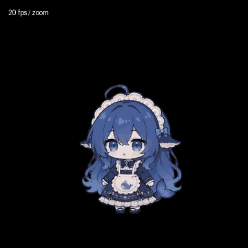

# ESP32-S3-N32R16：360×360 贴脸流畅配置

这是一套可选的 **20 fps 目标帧率**配置，针对 32 MB Flash、16 MB PSRAM 的 ESP32-S3。
默认仍使用兼容 16 MB 分区的资源；只有启用 `EXAMPLE_DAFEIYU_SMOOTH_32M` 才选择本套素材。
目前没有实机帧率测量，20 fps 是资源和渲染器的目标，不是已经验证的最低帧率。

## 实际变化

| 项目 | 原来的紧凑配置 | 32 MB 流畅配置 |
| --- | --- | --- |
| 贴脸动作 | 12 fps，通常只有 3 张不同帧 | 20 fps，每组 24 张不同源帧 |
| 空闲小表情 | 6 fps，复用短循环 | 20 fps，使用连续动作帧 |
| 贴脸待机 | 11 张不同源帧 | 44 张不同源帧，完整眨眼及眼神/嘴部变化 |
| 镜头拉近/退远 | 18 帧、15 fps、1.2 秒 | 24 帧、20 fps、1.2 秒 |
| 全身动画 | 12 fps | 保留 12 fps |
| 清晰度 | 离线超分，24 色 | 保留相同处理与颜色数 |
| anim_icon 分区 | 3000 KiB | 12 MiB |

原视频是 24 fps，新素材按每 50 ms 选取最接近的原始帧，时间误差不超过半个源帧。
没有在 ESP32 上做补帧，也没有把原来的三帧动画简单加速。前进/倒放共用压缩帧数据，
循环末尾能平顺回到开始。不同表情之间仍是二维动作切换，没有进行三维姿态插值。



现在采用单一连续眨眼动作，保留眼神和嘴部细微变化，不再在笑脸/歪头/揉眼之间定时切片。
说话、DSH 及情绪更新仅记录逻辑状态，退出贴脸后恢复最新表情。
退出请求等当前 4.3 秒循环的衔接点再退远（最多约 4.3 秒）；取消退出不会重播。
衔接点按播放时长估算，掉帧时仍可能偏离，需要实机检验。任意全身姿态进入镜头仍不是三维无缝变形。

## 为什么先采用 20 fps

16 MB PSRAM 增加的是容量，不能直接提高屏幕总线、解码和 CPU 的吞吐量。
脸部画布为 360×320，RGB565 每帧为 230,400 字节；20 fps 的像素传输量约 **4.61 MB/s**，
整屏 360×360 更新则约 **5.18 MB/s**。以上还未计算命令、DMA 间隙、字幕和渲染开销。

如果屏幕使用单线 SPI 40 MHz，理论上限只有 5 MB/s，20 fps 已很紧张，整屏刷新甚至超出理论带宽。
更快的 SPI 或 QSPI 才可能提供更大的余量；仅知道芯片型号，不能确认 VoCat v1.9 的实际总线配置。
30 fps 的脸部像素传输量约 6.91 MB/s，因此本版没有直接提升到 30/60 fps。

配置把 Emote 渲染节奏同步为 20 Hz，避免动画 20 fps、渲染上限 30 Hz 带来的不均匀呈现间隔。
保持现有渲染任务优先级、DMA 缓冲策略和板级引脚，不用提高任务优先级抢占音频任务。
资源仍通过原生 EAF 索引色解码器播放；4 倍超分仅在电脑生成素材时执行。
本次使用现有字体/图标打包为 **7,702,038 字节 / 12,582,912 字节**。
EAF 文件合计约 6.33 MB，最大的待机文件约 1.32 MB；原生播放器可能缓存已使用的动作，
因此要求 PSRAM 接入 malloc 堆（`CONFIG_SPIRAM_USE_MALLOC=y`），不能只启用 PSRAM 硬件。
还需给 LVGL、音频、网络及解码工作区留出空间，实际可用堆和最大连续空闲块须在板上确认。

## 启用与烧录

先保留当前已经在设备上验证过的板型、音频、屏幕引脚和 PSRAM 配置。
工程仍没有 VoCat v1.9 专用定义，不要因为本功能改用未经验证的 v1.0/v1.2 引脚。

在 `idf.py menuconfig` 中：

1. 确认目标芯片是 ESP32-S3、Flash 为 32 MB、PSRAM 已启用并被设备正确识别，且启用供 malloc 使用的外部 RAM。
2. Partition Table 选择 Custom，文件名填 `partitions_32m.csv`。
3. 保持 Dafeiyu 动画和 close-up 两项开启。
4. 启用 `Use 20 fps Dafeiyu close-up animations (S3, 32 MB, 360x360)`。
5. 确认实际屏幕配置为 360×360。

```powershell
cd examples/agent/chatbot
idf.py build
idf.py -p COMx flash monitor
```

必须完整烧录分区表、固件和资源。新的分区表只扩大最后的 anim_icon，其他已有分区的偏移与大小保持不变；
不需要为此执行 erase-flash。构建会拒绝错误的芯片、屏幕尺寸或不足 12 MiB 的动画分区。

新增 `sdkconfig.defaults.smooth32` 可作为新构建的 defaults 叠加文件，放在已验证的板级 defaults 之后。
它不是独立板级配置，且 defaults 不会覆盖已有 sdkconfig 的显式值；现有工程优先按上述 menuconfig 步骤修改。

## 实机验收与退回

先观察纯待机、连续拉近/退远，再同时开启 Wi-Fi、语音识别、TTS 播放和 DSH 状态同步。
重点检查音频是否断续、屏幕是否丢帧、是否发生内存分配失败或看门狗复位。
每帧的解码、渲染、刷屏总预算为 50 ms；不能把主机 Python 解码速度当成 S3 的性能测量。

如果板上带宽或音频并发无法稳定支撑，可关闭 `EXAMPLE_DAFEIYU_SMOOTH_32M` 后重新完整烧录。
可以保留 32 MB 分区表，打包器会换回原来的紧凑素材，镜头帧范围也自动匹配旧资源。

## 重新生成资源

沿用清晰度处理工具，需要 Pillow、支持 VP9 alpha 的 FFmpeg 和 waifu2x-ncnn-vulkan 20220728：

```powershell
python tools/prepare_dafeiyu_quality.py --source SOURCE_DIR --dsh-source DSH_GIT_DIR --output SMOOTH_FRAMES --ffmpeg FFMPEG_EXE --upscaler WAIFU2X_EXE --smooth
python tools/build_dafeiyu_smooth.py --enhanced SMOOTH_FRAMES
```

`assets/dafeiyu/smooth/360_360/source.json` 保存视频来源、帧号、重建 PNG 与最终 EAF 摘要。
日常 IDF 构建直接打包已提交 EAF，不运行超分工具。资源帧数、方向、动作时序、原分区兼容性和
两套配置的状态机均有主机测试；完整 IDF 编译和 S3 板上性能仍须实机验证。
本次通过 31 项主机测试、410 帧原生 RGB565 解码比对、紧凑/流畅两套 CMake 资源构建，
并验证了误用 3 MB 动画分区时构建会明确拒绝。
