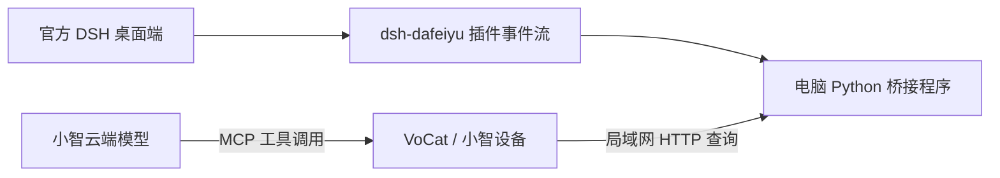

# 用小智语音查询电脑上的 DSH

本功能为官方 DSH 桌面端提供只读查询：当前任务状态、项目、正在处理的待办、
已完成/总待办数，以及插件提供的多任务列表。可以问小智：

- “电脑上的 DSH 现在在做什么？”
- “DSH 正在处理哪个项目？”
- “当前待办完成多少了？在等我确认吗？”

## 接入方式



大肥鱼插件已公开本机 SSE 事件流，但不是一个现成的 MCP 查询服务器。
这里由固件注册 `Custom.DSH.GetStatus` MCP 工具，电脑桥接程序读取事件流并提供查询结果。
无需在 DSH 的 MCP 设置中添加小智；DSH 的工具调用配置与“读取 DSH 自己的状态”方向不同。

目前新增功能默认关闭，启用后按语音需要查询。它不会创建/修改 DSH 任务，也不会让设备
自动播报或持续切换到 DSH 工作动画。角色动画仍按小智语音会话状态运行。

## 1. 安装桌面端插件

你目前尚未安装/启用插件，需先在官方 DSH 桌面应用完成：

1. 打开左侧 **插件 → 添加插件**。
2. 输入 `dsh-dafeiyu@0.1.18`，安装并立即启用；按桌面端提示刷新或重启。
3. 在桌面端的大肥鱼设置中保持“启用大肥鱼”开启，并在 DSH 中触发一次新任务。

本次按该版本的 `protocolVersion: 1` 事件协议实现。
插件安装在桌面端 `desktop` profile；独立 npm CLI 的 `web` profile 不会自动同步到这里。
插件主要观察启用后发生的会话事件，历史任务不会自动完整补齐。

## 2. 确认桌面 Host 地址及认证

官方桌面端默认绑定 `127.0.0.1`，使用随机端口，不能直接将 WebUI 默认 `3080` 当成
桌面端端口。参考 [官方桌面端文档](https://github.com/deepseek-ai/deepseek-harness/blob/master/apps/desktop/README.zh.md)。

可在桌面端按 **F12 / Ctrl+Shift+I** 打开 DevTools，在 **Network → WS** 找到
`ws://127.0.0.1:实际端口/...` 连接。将它的来源改写为 `http://127.0.0.1:实际端口`，
作为下文 `--source-url`。不要使用窗口文档的 `dsh-app://app/` 地址。

桌面 Host 可能要求自己的会话 Cookie。此时从该本机连接的 **Request Headers → Cookie**
取完整值，保存到本仓库 `.cache/dsh-bridge/source-cookie.txt`，例如一行 `cookie名称=值`，
不包含 `Cookie:` 前缀。桥接通过 `--source-cookie-file` 读取它；如果当前 Host 对插件
端点不要求 Cookie，可以省略该参数。Cookie 只在电脑上使用，不发送给 ESP32 或小智云端。

这份 Host Cookie 和下文的桥接访问令牌是两种不同凭据，都不是 DeepSeek API Key。
文件放在已忽略的 `.cache/` 目录；无需把内容发到聊天里。桌面 Host 重启后地址或 Cookie
可能改变，此时更新文件并重新启动桥接。

## 3. 先检测真实状态源

以下命令都从本仓库根目录执行，需要 Python 3.10+，无需额外 Python 包。
将 `实际端口` 替换为桌面端实际端口：

```powershell
python examples/agent/chatbot/tools/dsh_bridge.py --source-url http://127.0.0.1:实际端口 --source-cookie-file .cache/dsh-bridge/source-cookie.txt --probe
```

无 Cookie 要求时去掉 `--source-cookie-file ...`。成功会输出真实 JSON，`available` 为
`true`，退出码为 0。插件未启用、端口错误、未通过认证或协议不符时返回不可用和非零退出码；
不要继续把缓存当作实时状态。

## 4. 启动电脑桥接

将 `电脑局域网IP` 替换为 PC 在当前 Wi-Fi/局域网的 IPv4 地址，例如 `192.168.1.100`：

```powershell
python examples/agent/chatbot/tools/dsh_bridge.py --source-url http://127.0.0.1:实际端口 --source-cookie-file .cache/dsh-bridge/source-cookie.txt --bind 电脑局域网IP
```

桥接默认监听 TCP `8765`，自动生成并复用 `.cache/dsh-bridge/token.txt`。程序只打印
文件位置，不输出令牌内容。电脑与 VoCat 需能通过局域网互通，Windows 防火墙需允许此端口。
接口使用本地 HTTP 和 Bearer 令牌，适用于设备所在的可信局域网。

不填写 `--bind` 时只监听 `127.0.0.1`，便于本机诊断，ESP32 无法连接该地址。
也不要在固件中填写 `127.0.0.1`，它在 ESP32 上表示设备自己。

## 5. 配置小智固件

在已加载 ESP-IDF、板级配置可用的终端中，进入 `examples/agent/chatbot`，执行
`idf.py menuconfig`，在 **Example Configuration** 中配置：

| 配置项 | 内容 |
| --- | --- |
| Enable Xiaozhi agent | 开启 |
| Enable DSH desktop status MCP tool | 开启 |
| PC bridge base URL | `http://电脑局域网IP:8765`，不带 `/v1/status` |
| PC bridge access token | `.cache/dsh-bridge/token.txt` 中的完整内容 |

执行 `idf.py build` 和 `idf.py -p COMx flash monitor`，将 `COMx` 替换为实际串口。
运行时应注册 `Custom.DSH.GetStatus`。此后唤醒小智，提出开头的查询即可。
DSH 桌面端和 Python 桥接都需保持运行。

## 数据范围与诊断

- 只转发状态、项目、阶段、当前待办及完成计数；忽略余额、配置及其他任意事件字段。
- 有真实待办计数时返回 `completed/total`；缺少计数时返回 `progress: null`，不估算百分比。
  待办计数也不代表实际耗时百分比。
- 上游多任务列表没有完整待办计数；当前选中会话以外的任务不补造计数。最多返回 6 项。
- 断线返回 `available: false`、`stale: true`，缓存保留用于诊断。SSE 无心跳时约 20 秒
  重连并重新读取快照，空闲期间不会因没有任务事件而永久失去状态。
- 每次重连先检查插件开关，避免关闭插件后误用残留的快照。

| `connection_error` / 现象 | 检查方向 |
| --- | --- |
| `source_http_401` / `source_http_403` | 桌面 Host Cookie 是否匹配当前实例 |
| `source_http_404` | 端口、插件是否安装，当前版本是否有事件端点 |
| `source_plugin_disabled` | 在大肥鱼设置中开启插件 |
| `waiting_for_state` | 插件是否已开始发送状态；触发一次新任务 |
| `source_unreachable_or_invalid` | Host 是否运行、地址或 Cookie 文件是否正确、协议是否兼容 |
| PC bridge token does not match | 固件令牌与电脑 `token.txt` 是否一致 |
| PC bridge is unreachable | 桥接是否运行、LAN IP、监听地址、防火墙及 Wi-Fi 隔离 |

状态查询接口为 `GET /v1/status`，要求 `Authorization: Bearer <桥接令牌>`，响应最多
8192 字节。它不是通用 MCP HTTP 端点，不提供任务写入操作。

## 二次开发与验证

- `tools/dsh_bridge.py`：SSE 订阅、桌面 Host 认证、字段过滤、缓存及局域网查询接口。
- `main/modules/dsh_bridge.cpp`：小智 MCP 注册、带令牌的 HTTP 查询与结构化错误返回。
- `main/modules/ai_agents.cpp`：在小智启动前注册工具。
- `main/Kconfig.projbuild`：可选功能、PC 地址和桥接令牌配置。

在仓库根目录运行主机测试：

```powershell
python -m unittest discover -s examples/agent/chatbot/tools/tests -v
```

已通过 10 项桥接测试，包括真实回环 HTTP/SSE 请求、Host Cookie、插件禁用、鉴权失败、
旧快照、多会话、断线和响应大小限制；加上 6 项表情资源测试，共 16 项。
当前环境没有 ESP-IDF，尚未进行启用该功能的完整固件编译；你尚未安装/启用桌面插件，
也尚未进行真实 DSH 和 VoCat v1.9 的端到端联调。
