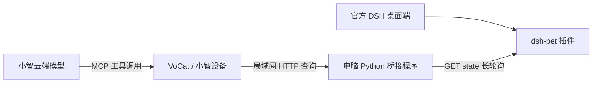

# 用小智语音查询电脑上的 DSH（dsh-pet）

本页是旧的独立 Python 桥接方案。需要自动同步动画并由 DSH 直接推送时，请使用
[DSH 直接推送方案](./DSH_PET_SYNC_CN.md)，该方案的语音查询也直接读取设备缓存。

电脑桥接已迁移到 [PC2005-cloud/dsh-pet](https://github.com/PC2005-cloud/dsh-pet)，
通过小智 MCP 工具查询插件发布的工作状态和当前任务文本。可以问：

- “电脑上的 DSH 现在在做什么？”
- “DSH 还在执行，还是正在整理结果？”
- “DSH 在等我确认吗？”

**能力边界：** `dsh-pet` 的公开接口只有工作状态与当前任务文本，没有项目名、
待办完成数/总数或多任务列表。这些字段返回 `null` / 空列表，`capabilities` 明确标为
不支持。询问项目或完成百分比时，小智应说明数据缺失。若后续需要完整项目和进度，
需要另外接入 DSH 会话/待办数据或扩展插件，不能从动画、任务文案中推算。

## 接入方式



桥接读取 `GET /dsh-pet-7340/state` 中的 `sections.workStatus.data`，固件注册
`Custom.DSH.GetStatus` MCP 工具。无需在 DSH 的 MCP 设置中添加小智。
该功能默认关闭，启用后按语音需要查询；角色动画仍按小智语音会话状态运行。

本次适配依据：上游 **0.3.8** 的
[OpenAPI 契约](https://github.com/PC2005-cloud/dsh-pet/blob/48007b64ac0bebb2e97ac88344aed62de8399dd4/openapi.yaml)
与 [API 说明](https://github.com/PC2005-cloud/dsh-pet/blob/48007b64ac0bebb2e97ac88344aed62de8399dd4/API.md)。
本工程已有的角色资源来自同一角色素材谱系，其来源与许可保留在
[资源说明](./assets/dafeiyu/README_CN.md) 中；桥接迁移无需重新导入动画。

## 1. 安装桌面端插件

1. 在官方 DSH 桌面应用打开 **插件管理 → 添加插件**，输入 `dsh-pet@0.3.8` 安装并启用。
2. 安装后完全退出并重新打开 DSH 桌面应用。
3. 在宠物设置中开启工作状态跟随（`workStatusEnabled`），并在 DSH 中触发一次新任务。

上游说明该版本在 DSH `0.2.1-rc.2` 下开发与测试，使用其他版本时需先验证兼容性。
桌面应用与独立 CLI / `dsh web` 的 profile 不互通，应在你实际使用的桌面应用内安装。
如先前安装了 `dsh-dafeiyu`，可在插件管理中停用它；此桥接只读取 `dsh-pet`。

请使用 **DSH 内加载的插件**作为数据源。独立 `dsh-pet` 模式虽然也有 `/state`，
但没有真实 DSH 会话活动；仅接口可访问不能证明正在同步 DSH。

## 2. 确认桌面 Host 地址

官方桌面端 Host 默认绑定回环地址并使用随机端口；不要直接套用 `dsh web` 默认的
`3080`。`dsh-pet-7340` 是固定路由前缀，**7340 不是端口号**。参考
[官方桌面端文档](https://github.com/deepseek-ai/deepseek-harness/blob/master/apps/desktop/README.zh.md)。

在 DSH 桌面端按 **F12 / Ctrl+Shift+I** 打开 DevTools，在 **Network → WS** 找到
`ws://127.0.0.1:实际端口/...`，将来源改为 `http://127.0.0.1:实际端口` 作为
`--source-url`。也支持填写 `http://127.0.0.1:实际端口/dsh-pet-7340`。
不要填写 `dsh-app://app/` 或宠物自己的 `dsh-pet-bridge://` 地址。

插件公开 HTTP 接口本身无鉴权，先不传 Cookie 进行检测。如果桌面 Host 外层返回
401/403，可从上述连接的 **Request Headers → Cookie** 取完整值，保存在
`.cache/dsh-bridge/source-cookie.txt`，再添加
`--source-cookie-file .cache/dsh-bridge/source-cookie.txt`。
文件仅一行完整 Cookie 值，不含 `Cookie:` 前缀；Cookie 只留在电脑上。
Host 重启后端口或 Cookie 可能变化，需更新后重启桥接。

## 3. 检测真实状态源

在本仓库根目录执行，需要 Python 3.10+，无需额外 Python 包。替换 `实际端口`：

```powershell
python examples/agent/chatbot/tools/dsh_bridge.py --source-url http://127.0.0.1:实际端口 --probe
```

成功时输出 `source: "dsh-pet"`、`available: true`，退出码为 0。未发布过工作状态时，
返回 `connected: true`、`available: false`、`connection_error: "waiting_for_work_status"`，
退出码非零；在 DSH 中新建任务后重试。

`workStatus.data: null` 表示没有状态数据，不能解释为空闲；
`workStatus.data: {"state": null, "task": null}` 才表示已发布的空闲状态。

## 4. 启动电脑桥接

替换 `电脑局域网IP`，例如 `192.168.1.100`：

```powershell
python examples/agent/chatbot/tools/dsh_bridge.py --source-url http://127.0.0.1:实际端口 --bind 电脑局域网IP
```

桥接默认监听 TCP `8765`，自动生成并复用 `.cache/dsh-bridge/token.txt`，仅打印令牌
文件位置。不需要 DeepSeek API Key。电脑与 VoCat 需能通过局域网互通，Windows
防火墙需允许桥接端口；接口采用本地 HTTP 与 Bearer 令牌，适用于可信局域网。

不传 `--bind` 时仅监听 `127.0.0.1`，ESP32 无法连接。固件地址也不能写 `127.0.0.1`，
它在设备上表示设备自身。插件源接口仍只在电脑回环地址读取。

## 5. 配置小智固件

在已加载 ESP-IDF、板级配置可用的终端中，进入 `examples/agent/chatbot`，执行
`idf.py menuconfig`，在 **Example Configuration** 配置：

| 配置项 | 内容 |
| --- | --- |
| Enable Xiaozhi agent | 开启 |
| Enable DSH desktop status MCP tool | 开启 |
| PC bridge base URL | `http://电脑局域网IP:8765`，不带 `/v1/status` |
| PC bridge access token | `.cache/dsh-bridge/token.txt` 的完整内容 |

执行 `idf.py build` 和 `idf.py -p COMx flash monitor`，替换实际串口。
运行时应注册 `Custom.DSH.GetStatus`，此后唤醒小智并查询。
DSH 桌面端与 Python 桥接都需保持运行。

从旧桥接迁移时，PC 的监听地址、端口和令牌可以复用；固件需重新编译烧录，
以更新 MCP 工具说明，使模型知道当前数据源不提供项目名与完成计数。
VoCat v1.9 的板级引脚与屏幕配置仍需按实物确认，不能直接假定兼容现有 v1.2 配置。

## 数据范围与诊断

- 状态映射：`thinking` → 思考，`working` → 执行，`result` → 整理结果，
  `waiting` → 等待确认，`success` → 完成，`error` → 出错，`null` → 空闲。
- 只转发公开的工作状态与任务文本；项目、进度和会话 ID 为 `null`，任务列表为空。
  不导出余额、配置、宠物对话、Cookie 等其他字段。任务文本最多 120 字符。
- `dsh-pet` 允许其他本机客户端通过 `/work-status` 覆盖发布状态，因此此结果代表
  **插件当前发布值**，不能保证始终等同 DSH 内部完整任务状态。本桥接仅发送 GET。
- 首次完整读取 `/state`；随后用顶层 `counter` 与 `timeout=10000` 成对长轮询。
  断线重试重新拉完整快照。版本号不变仍刷新连接活性，避免空闲被误判掉线。
- `updated_at` 来自工作状态叶子的版本时间；`sync_age_seconds` 表示距成功读取接口
  的时间。宠物动画等无关叶子更新不改变工作状态时间。
- 请求失败立即标为 `available: false`、`stale: true`；缓存仅用于诊断，不能作为实时状态。
  超过 45 秒未同步也视为不可用。源快照上限 256 KiB，设备响应上限 8192 字节。

| `connection_error` / 现象 | 检查方向 |
| --- | --- |
| `source_http_401` / `source_http_403` | 桌面 Host 外层认证；按第 2 步配置 Cookie |
| `source_http_404` | 实际 Host 端口、`dsh-pet` 是否在桌面 profile 安装启用、是否已重启 |
| `waiting_for_work_status` | 插件尚未发布状态；启用工作状态跟随并触发新任务 |
| `source_unreachable_or_invalid` | Host 是否运行、Cookie 文件、响应大小或公开契约是否匹配 |
| PC bridge token does not match | 固件令牌是否与电脑 `token.txt` 一致 |
| PC bridge is unreachable | 桥接进程、LAN IP、监听地址、防火墙及 Wi-Fi 隔离 |

查询接口为 `GET /v1/status`，要求 `Authorization: Bearer <桥接令牌>`。
它不是通用 MCP HTTP 端点；MCP 工具位于小智固件中。

## 二次开发与验证

- `tools/dsh_bridge.py`：dsh-pet 长轮询、可选 Host Cookie、字段过滤及局域网查询。
- `main/modules/dsh_bridge.cpp`：小智 MCP 注册、带令牌查询与结构化错误返回。
- `main/modules/ai_agents.cpp`：在小智启动前注册工具。
- `main/Kconfig.projbuild`：可选功能、PC 地址与桥接令牌。

仓库根目录运行：

```powershell
python -m unittest discover -s examples/agent/chatbot/tools/tests -v
```

已通过 15 项桥接测试，覆盖公开状态、缺失字段、空闲活性、断线恢复、长轮询参数、
真实回环 HTTP、可选 Cookie、鉴权、重定向、无效响应与大小限制；加上 6 项资源测试，
共 21 项。当前环境没有 ESP-IDF，尚未完成启用该功能的完整固件编译，
也尚未完成真实 DSH 插件与 VoCat v1.9 的端到端联调。
