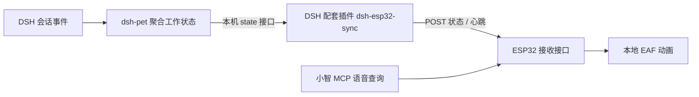

# DSH 直接推送状态到 ESP32

本方案由 **DSH 内的配套插件**读取 `dsh-pet` 的工作状态，通过局域网直接推送到 VoCat。
设备收到状态后播放已经烧录到 Flash 的 EAF 动画，不经过小智云端选择动作，也不需要
另外启动 Python。小智语音查询同样可以读取设备收到的快照。



配套插件源码在 [integrations/dsh-esp32-sync](./integrations/dsh-esp32-sync/README_CN.md)，
无需修改上游 `dsh-pet`。适配基线为 `dsh-pet 0.3.8`（上游提交
`48007b64ac0bebb2e97ac88344aed62de8399dd4`），DSH Host 需要提供
`webServer` 和 `connection.authenticatedUrl()` 服务。桌面插件的实际加载仍需在你的 DSH
版本验证；上游 `dsh-pet` 声明的开发测试版本是 DSH `0.2.1-rc.2`。

## 1. 确认设备与地址

先让 VoCat 连上电脑所在的 Wi-Fi，并从串口/路由器确认设备 IPv4 地址，例如
`192.168.1.80`。建议在路由器中为设备保留 DHCP 地址。下文端口默认 `8766`。

工程尚无 VoCat v1.9 专属板级定义；需要先确认实物引脚、屏幕配置和现有板定义是否兼容，
不要直接假定等同 v1.2。本功能不修改板级引脚。

## 2. 生成两端一致的配置

从仓库根目录执行（Node.js 22.12+，配套插件无 npm 依赖），替换设备 IP：

```powershell
node examples/agent/chatbot/integrations/dsh-esp32-sync/configure.cjs --device-url http://192.168.1.80:8766
```

脚本生成并保留同一令牌，写入两个文件，只打印路径：

- `%USERPROFILE%/.dsh/esp32-sync.json`：DSH 插件的配置，包含 `deviceUrl` 和 `token`。
- 本仓库 `.cache/dsh-esp32/sdkconfig.defaults`：固件所需的配置片段。

已有 DSH 配置中的令牌会复用，设备换 IP 后可再次运行该命令。DSH 插件启动时读取配置，
改完需要重启 DSH。文件内容不要提交到 Git；`.cache` 已忽略。
也可通过脚本 `--config`、`--firmware-config` 指定输出路径；自定义 DSH 配置路径时，
通过启动 DSH Host 的环境变量 `DSH_ESP32_CONFIG` 或插件配置 `configFile` 指向该文件。

## 3. 配置与烧录固件

进入 `examples/agent/chatbot`，在 ESP-IDF 终端运行 `idf.py menuconfig`。
在 **Example Configuration** 中设置：

| 配置项 | 内容 |
| --- | --- |
| Use Dafeiyu character animations | 开启 |
| Enable direct DSH pet state push and local MCP status | 开启 |
| DSH push receiver TCP port | `8766`，与 DSH 配置地址一致 |
| DSH push receiver access token | 上述配置文件中的 `token` |
| Enable Xiaozhi agent | 需要语音查询时开启 |

生成的 `.cache/dsh-esp32/sdkconfig.defaults` 包含这三个同步配置项，方便本机复制到
menuconfig 或用于自定义 `SDKCONFIG_DEFAULTS`。**脚本不会自动合并现有 sdkconfig**，
使用 defaults 时仍需保留原有默认配置和正确板型。

旧的 **Enable DSH desktop status MCP tool**（Python 方案）与直接推送选项互斥；
启用直接推送时，小智的 `Custom.DSH.GetStatus` 自动改为读取本地缓存，无需 PC 桥接地址。

执行：

```powershell
idf.py build
idf.py -p COMx flash monitor
```

替换实际串口。设备连接 Wi-Fi 后应输出 `DshPetSync: Listening for DSH status on TCP 8766`。
接收器仅在 STA Wi-Fi 连接期间运行；配网 SoftAP 未连接 STA 时不启动。
如端口被占用，每 5 秒重试；令牌为空或格式错误会禁用接收器，不影响原聊天功能。

## 4. 在 DSH 中安装两个插件

1. 在你实际使用的官方 DSH 桌面应用的 **插件管理** 安装启用 `dsh-pet@0.3.8`。
2. 将本工程配套插件打包。仓库根目录执行：

   ```powershell
   New-Item -ItemType Directory -Force .cache/dsh-esp32 | Out-Null
   npm.cmd pack ./examples/agent/chatbot/integrations/dsh-esp32-sync --pack-destination .cache/dsh-esp32
   ```

3. 在同一 DSH 桌面应用的 **插件管理 → 添加插件** 填入绝对包路径，例如：
   `file:C:/Users/yt0368/Desktop/Project/esp-brookesia/.cache/dsh-esp32/dsh-esp32-sync-0.1.0.tgz`。
   如果当前应用不接受 `file:` 安装，使用应用自带 CLI 将这个包安装到同一 `desktop` profile；
   不要改装到独立系统 CLI 的 `web` profile。
4. 完全退出并重新打开 DSH，确认配套插件启用；日志应出现
   `[dsh-esp32-sync] Direct ESP32 state forwarding started.`。
5. 在 DSH 里开始新任务，观察设备动画。桌面宠物本身需要开启 `workStatusEnabled`
   才显示对应动画；配套插件读取 Host 已聚合的状态，不要求桌面宠物窗口一直可见。

配套插件自动读取实际 Host 端口，不需要手工填写 DSH 随机端口。
Host 要求认证时，通过 `connection.authenticatedUrl()` 换取本机 Cookie；Cookie 只在
DSH 进程内存中使用，不落盘、不进入日志、不发送到 ESP32。
动画状态使用 HTTP 与设备直连，仍需电脑到设备的端口可达、同一局域网无客户端隔离。

## 状态与显示规则

| DSH 状态 | 本地表情名 | 已有动画 |
| --- | --- | --- |
| 空闲（`state: null`） | neutral | idle |
| thinking | thinking | thinking |
| working | speaking | working |
| result | thinking | thinking（复用） |
| waiting | confused | thinking（复用） |
| success | happy | success |
| error | sad | error |

- 设备同步的是工作状态，图片在设备本地播放；不传输 WebM 视频或逐帧画面。
  `result`、`waiting` 暂时复用已有素材，后续可单独增加资源。
- 变化时立即唤醒推送；状态不变时每约 5 秒发送心跳。上游 Host 长轮询最多挂起 10 秒，
  推送循环独立运行，不会因为长轮询等待而停止心跳。若 POST 期间又变更状态，完成后发送最新值。
- ESP32 收到 15 秒内的有效快照视为实时。源接口出错会推送 `available: false`，
  DSH 整体退出/电脑断线时设备最多在 15 秒超时后恢复待机。
- 本地小智会话从唤醒到睡眠/停止优先显示聆听、思考、说话及云端情绪；DSH 快照继续缓存。
  会话结束后显示最新 DSH 状态；配网、系统反馈的本地动作另有约 1.5 秒显示时间。
- 成功/失败显示最多 5 秒后回到待机，心跳不会不断重播庆祝；语音查询仍返回真实发布状态。
- 状态相同不会每次收到心跳都重启动画。只更新任务文案时也不重启动画。
- 不强制切换当前屏幕；设置页、摄像头预览等仍由原显示逻辑控制。
- 公开数据没有项目名、完成计数或完整任务列表；小智不能据此计算完成百分比。
  插件发布值也可能被其他客户端的 `/work-status` 写入覆盖。

## 两个接口

设备端：`POST http://设备IP:8766/api/pet/state`，必须携带
`Authorization: Bearer <token>` 与 `Content-Type: application/json`，消息格式：

```json
{
  "schema_version": 1,
  "source": "dsh-pet",
  "publisher_id": "00000000-0000-4000-8000-000000000001",
  "sequence": 1,
  "available": true,
  "state": "working",
  "task": "正在修改代码"
}
```

`publisher_id` 标识插件进程，`sequence` 在该进程内递增；同进程序号倒退/重复返回 409。
新插件进程可从 1 开始。当前仅设计为单个 DSH 发布者对应一台设备。
`available: false` 时 `state` 和 `task` 都必须为 `null`，用于清除旧状态。
请求最多 1024 字节；任务文本最多 120 个码点，非空闲状态只允许表中的六种。
成功回复 `{"ok":true,"sequence":1}`。401 表示令牌不匹配，400 表示协议错误。
该接口使用可信局域网 HTTP，不提供图片上传或任意动画 URL 执行。

DSH 端：`GET /dsh-esp32-sync/status`（位于同一 Host 下，沿用其访问认证），返回
源/设备连接错误、最近读取和推送时间，不包含令牌、Cookie 或任务文本。
在 DSH 桌面 DevTools 的 Network 中或已认证 Host 页面调用此路由即可诊断。

| 错误 / 现象 | 检查方向 |
| --- | --- |
| 配套插件提示 Configure | `~/.dsh/esp32-sync.json` 是否存在、JSON 格式及设备地址/令牌是否正确 |
| `source_http_404` | `dsh-pet` 是否在同一 Host 安装启用并已重启 |
| `source_auth_failed` | DSH Host 认证服务与当前版本兼容性 |
| `waiting_for_work_status` | 在 DSH 中触发新任务，不能把未写入状态解释为空闲 |
| `device_http_401` | 两端令牌是否一致，是否已重新编译烧录 |
| `device_unreachable` | ESP32 接收器是否启动、设备 IP、端口、防火墙或 AP 隔离 |
| `device_http_409` | 是否有两个插件实例同时向同一设备推送；只保留一个发布者 |
| 语音期间不切 DSH 动画 | 属于预期优先级；结束语音会话后恢复最新状态 |

## 开发验证

仓库根目录执行：

```powershell
node --test examples/agent/chatbot/integrations/dsh-esp32-sync/test/*.test.cjs
python -m unittest discover -s examples/agent/chatbot/tools/tests -v
```

Node 测试覆盖真实回环 HTTP 数据流、长轮询、认证 Cookie 隔离、心跳、源断线、
设备失败恢复、推送并发与插件卸载取消。Python 测试包含原资源/桥接回归，以及使用 g++
编译执行实际固件动画仲裁类，以及使用 ESP-IDF API 替身执行真实接收处理函数、JSON 解析、
鉴权、重放拒绝和 MCP 缓存状态的原生测试（缺少 g++ / Boost.JSON 时对应项会跳过）。
当前通过 15 项 Node 测试与 23 项主机测试（含两项原生 C++ 编译执行检查）。
当前环境没有 ESP-IDF，未完成启用功能的完整固件编译；Host 插件测试使用模拟 DSH 服务，
真实 DSH 插件安装加载和 VoCat v1.9 网络/显示联调尚未完成。
